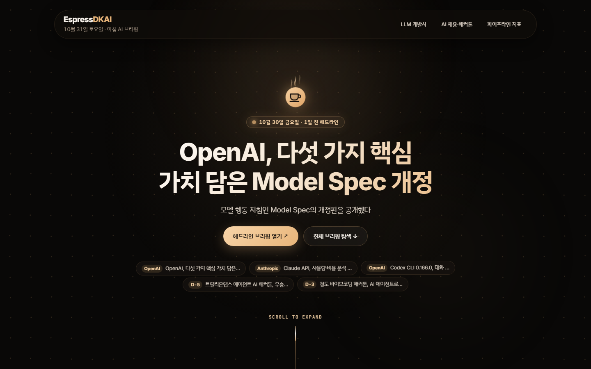
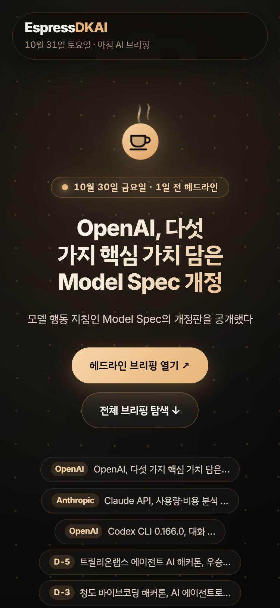
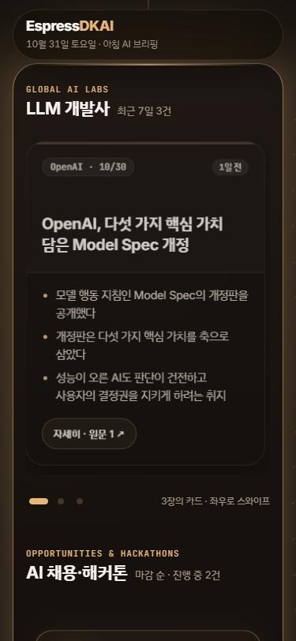
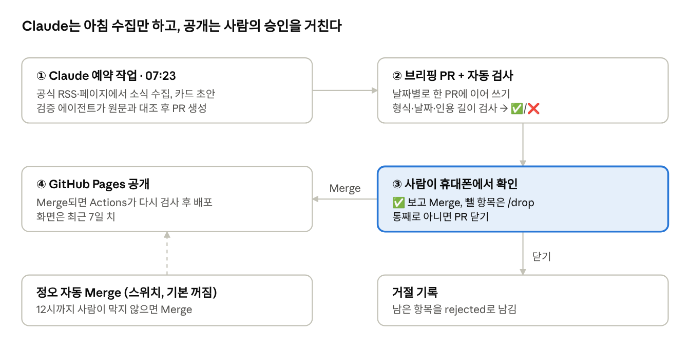
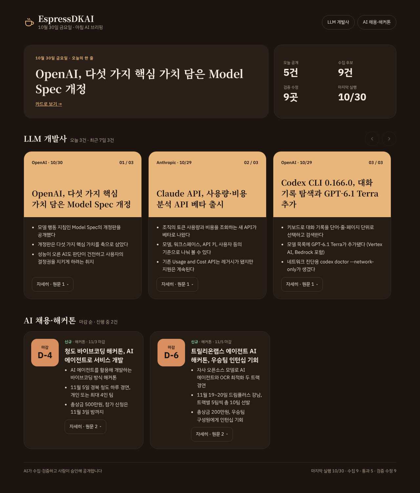

# EspressDKAI

**AI 채용·해커톤 소식과 주요 AI 기업 소식을 매일 아침 한 장으로.**
AI가 모으고 검증하고, 사람이 승인한 것만 공개하는 브리핑 사이트.

**[브리핑 보기 →](https://ekzmzm79-github.github.io/EspressDKAI/)**



## 왜 만들었나

생성형 AI를 다룰 줄 아는 인재를 찾는 채용이 빠르게 늘고 있다. 그런데 관련 채용·해커톤 소식은 여기저기 흩어져 있었고, 이를 한곳에서 보고 싶었다.
만들다 보니 채용만 보아서는 업계가 어디로 가는지 보이지 않았다. 그래서 주요 AI 기업(OpenAI·Google·Anthropic)의 소식을 함께 실어, 채용 시장과 업계 흐름을 한 화면에서 읽을 수 있게 했다. 출퇴근길에 꾸준히 보도록 휴대폰에 맞췄다.

## 무엇을 하나

매일 아침 7시 23분, AI가 두 가지 소식을 모아 한 장짜리 웹페이지 초안을 만든다.

| 섹션 | 출처 | 화면 |
|---|---|---|
| **주요 AI 기업 소식** | OpenAI·Google·Anthropic의 공식 블로그, 릴리스 노트, 변경 기록 | 옆으로 넘기는 카드 |
| **국내 AI 채용·해커톤** | 검색으로 찾은 공고를 원문으로 확인 | 마감이 가까운 순. 마감이 지나면 빠진다 |

- 소식마다 2~3줄 요약과 원문 링크
- 최근 7일 치를 보여 주고, 지난 소식은 "N일 전"으로 접힌다
- 한 번 공개한 사건은 다시 싣지 않는다

<p>
  
  
</p>

## 어떻게 돌아가나



- **AI가 하는 일은 아침 수집 하나뿐이다.** 검사, 배포, 거절 기록은 모두 GitHub Actions 스크립트가 맡는다.
- **공개는 사람이 정한다.** AI가 가져온 안건이 AI가 알 수 없는 맥락 때문에 맞지 않을 때가 있어서다. 휴대폰으로 PR을 보고 Merge하거나, 뺄 항목만 `/drop`하거나, 닫는다.
- **승인을 깜빡해도 꼬이지 않는다.** 열린 브리핑 PR이 있으면 다음 날 실행이 같은 PR에 이어 쓴다.
- **AI의 초안은 다른 AI가 원문과 대조한다.** 초안을 쓴 맥락을 모르는 별도 에이전트가 기사 원문과 문장을 하나씩 맞춰 보고, 근거 없는 주장은 지운다.

## AI와 함께 만든 방식

기획부터 운영까지 여러 AI 세션과 모델에 역할을 나눠 맡기고, 판단은 사람이 했다.

1. **기획**: 기획안을 쓰는 세션과 검토하는 세션(Gemini, 다른 세션의 Claude, ChatGPT)을 나눴다. 한 세션이 자기 맥락 안에서 놓치는 것을 다른 시각으로 잡기 위해서다.
2. **구현**: 개정된 기획안을 새 진행 세션에 넘겨 한 번 더 훑고, 단계별(M0~M3)로 만들었다.
3. **디자인**: Claude가 데모를 만들고, Gemini가 방향 지시대로 개편하고, 다시 Claude가 검수했다.
4. **운영**: 매일 아침 Claude 클라우드 루틴이 [작업 규칙](docs/runbook.md)을 따라 실행한다.

### 판단의 순간들

- **승인을 깜빡해도 꼬이지 않는 PR 흐름.** 기획서는 매일 새 PR을 여는 방식이었다. 검토 중에 "승인을 미루면 같은 소식이 또 올라오고, 두 PR이 충돌한다"는 문제가 나왔다. 주기를 일주일로 늘리는 안은 버렸다. 매일 흐름을 보는 게 목적이고, 마감이 주중에 지나가기 때문이다. 대신 열린 PR 하나에 이어 쓰는 방식을 골랐고, 실제 GitHub에서 두 번째 실행이 같은 PR에 붙는 것까지 확인했다. ([#8](https://github.com/ekzmzm79-github/EspressDKAI/pull/8))
- **교차 검토를 한 번에서 끊다.** 모델끼리 검토 의견에 의견이 꼬리를 물었지만, 품질은 소수점을 맞추는 수준으로만 올랐다. 검토는 한 번에서 끊고 직접 만들어 보며 맞춰 가기로 했다. 외부 검토는 결과물이 나온 뒤 디자인 단계로 옮겼다.
- **다른 모델의 디자인 개편을 검수하다.** Gemini의 개편을 Claude가 휴대폰·PC 화면, 키보드 조작, 접근성 검사, "9일 뒤에 연 화면"까지 확인해 8건을 고쳤다. 실제로는 수동 실행인데 "자동 수집"이라 적힌 문구, 모달 밖으로 빠지는 Tab 키, 오래된 헤드라인이 첫 화면을 차지하는 문제 등이다. ([#16](https://github.com/ekzmzm79-github/EspressDKAI/pull/16)~[#19](https://github.com/ekzmzm79-github/EspressDKAI/pull/19))

## 화면이 바뀐 과정

에스프레소 다크, 아침 신문, 스와이프 카드뉴스 세 시안을 비교해 에스프레소의 색감과 넘기는 카드를 골랐다.
Claude가 만든 데모(왼쪽)는 첫 화면을 헤드라인과 실행 지표가 나눠 가졌다. Gemini 개편에서는 첫 화면이 헤드라인 하나에 집중하고, 지표는 아래로 내려갔다.

<p>
  
  
</p>

## 현재 상태

2026-10-28 시작, 10-30 첫 브리핑 공개.

- **끝난 것**: 데이터 형식과 검사, 이어 쓰기 PR, GitHub Pages 배포, 디자인 개편과 검수, 매일 아침 예약 실행(10-31부터)
- **남은 것**: 몇 차례 연속으로 그대로 승인되면 정오 자동 Merge 켜기. 그 뒤에도 사람이 끼어들 수 있는 구조는 그대로 둔다.

---

## 개발자용

### 구조

```
docs/runbook.md          예약 실행이 따르는 작업 규칙 (AI용)
docs/development.md      개발 규칙, 외부 모델 검토 규칙
docs/implementation-plan.md  설계 결정(C1~C13)과 단계(M0~M5)
config/sections/*.yaml   섹션별 출처, 수집 기간, 권장 개수
schema/                  데이터 형식 (JSON Schema)
data/days/               하루치 브리핑 (AI가 쓰는 곳)
data/runs/               실행 기록
data/decisions/          사람의 거절 기록 (Actions만 씀)
scripts/                 수집·검사·PR·빌드 스크립트 (Python)
site/                    페이지 템플릿과 정적 파일
.github/workflows/       PR 검사, /drop, 거절 기록, 배포, 자동 Merge
```

### 로컬에서 실행

```bash
pip install -r requirements.txt
python -m pytest -q                 # 테스트
python scripts/validate.py          # 데이터 형식 검사
python scripts/build.py             # data/ → _site/
```

### 기술

Python 3.12 (jsonschema, Jinja2, PyYAML) · GitHub Actions · GitHub Pages · Claude Code 클라우드 루틴
